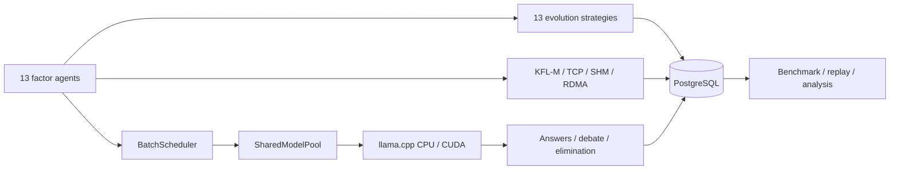

<div align="center">

[English](README.md) · [简体中文](README.zh-CN.md) · [Русский](README.ru.md)


# Civilization Spark

**A 13-factor multi-agent LLM civilization lab**

13 agents · shared llama.cpp model · 13 AI learning routes · CUDA · PostgreSQL · KFL-M

[](https://isocpp.org/)
[](https://developer.nvidia.com/cuda-toolkit)
[](https://www.postgresql.org/)
[](LICENSE)
[](https://github.com/TanLB1289808226/civilization-spark/actions/workflows/ci.yml)

</div>

---

## What is this?

Civilization Spark is a C++23 multi-agent LLM laboratory. Thirteen factor agents share one
llama.cpp model and KV context, while each agent follows a different modern AI learning route
and its own evolution rule. Through debate, learning, elimination, and rebirth they keep
answering one question:

> **What is the first cause of life?**

The project is designed for research and prototyping around:

- multiple agents sharing one model, KV cache, and batch decoder;
- long-term differences between learning strategies;
- reliable persistence and replay of agent state;
- compressed messaging over TCP, shared memory, and RoCEv2;
- custom CUDA kernels alongside the llama.cpp GPU backend.

It is not intended to replace a general-purpose chat product.

## Highlights

| Capability | Implementation |
| --- | --- |
| 13 factor agents | Heir, Titan path, drive, simulated path, AI route, unique evolution |
| Shared inference | `SharedModelPool` + multi-sequence batch decode + KV sliding window |
| 13 learning routes | Consensus, constrained RL, replay, evolution strategies, adversarial, distillation, reward, critique, regularization, competition, pruning, exploration, meta-learning |
| Compressed messaging | KFL-M v4, CRC8 / CRC32C, TCP / SHM / RoCEv2 interfaces |
| Persistence | PostgreSQL 18 / libpq: runs, agents, rounds, events, metrics, benchmarks |
| GPU | llama.cpp CUDA backend + custom elementwise / softmax attention |
| Benchmarking | Multi-seed, multi-repeat runs written directly to PostgreSQL |
| Reproducibility | Fixed seeds, deterministic evolution, queryable run records |

## Architecture



## The 13 factors

<details>
<summary>Expand the factor and AI-route table</summary>

| # | Factor | Heir | Path | Drive | Simulated path | AI learning route |
| --- | --- | --- | --- | --- | --- | --- |
| 0 | Tribios | 缇宝 | 门径 | 同理 | 同谐 | Multi-agent consensus learning |
| 1 | HubRis504 | 刻律德菈 | 律法 | 支配 | 秩序 | Constrained reinforcement learning |
| 2 | PhiLia093 | 昔涟（最初的因子） | 岁月 | 哀怜 | 记忆 | Continual learning and experience replay |
| 3 | 丹恒·腾荒 | 丹恒·腾荒 | 大地 | 求存 | 不朽 | Evolution strategies |
| 4 | ApoRia432 | 海瑟音 | 海洋 | 自否 | 虚无 | Adversarial learning and negative sampling |
| 5 | 雅辛忒丝 | 风堇 | 天空 | 奉献 | 存护 | Knowledge distillation and cooperative learning |
| 6 | NeiKos496 | 白厄 | 负世 | 憎恨 | 毁灭 | Reward-maximizing reinforcement learning |
| 7 | SkeMma720 | 那刻夏 | 理性 | 批判 | 智识 | Active learning and symbolic reasoning |
| 8 | 阿格莱雅 | 阿格莱雅 | 浪漫 | 节制 | 纯美 | Regularization and aesthetic constraints |
| 9 | 迈德漠斯 | 万敌 | 纷争 | 约束 | 巡猎 | Competitive co-evolution |
| 10 | EpieiKeia216 | 遐蝶 | 死亡 | 平和 | 均衡 | Model pruning and balanced learning |
| 11 | OreXis945 | 赛飞儿 | 诡计 | 渴望 | 欢愉 | Curiosity-driven exploration |
| 12 | 德谬歌 | 昔涟（第十三因子） | 岁月/全世 | 爱？（待确认） | 记忆/开拓 | Meta-learning and multimodal fusion |

</details>

The profiles, first-cause answers, and evolution methods live in the
`kAgentProfiles` table in [`src/ai/llm_agent.cpp`](src/ai/llm_agent.cpp).

## Sample output

```text
Agent  0 | Tribios / 缇宝 | 门径 · 同理 → 同谐
         AI route: multi-agent consensus learning
         Evolution: consensus distillation toward the collective representation
         First cause: the first cause of life is empathy: isolated minds become a
         civilization only when they are willing to understand each other.

[Phase 2: 13 AI learning routes evolve in parallel]
  Agent  0 Tribios    | Multi-agent consensus learning | efficiency 1.0000 -> 1.0485
  Agent  6 NeiKos496  | Reward-maximizing RL           | efficiency 1.0000 -> 1.0738
  Agent 12 德谬歌      | Meta-learning / multimodal     | efficiency 1.0000 -> 1.0600
```

## Quick start

### Linux / rented GPU: one command

```bash
git clone --recursive https://github.com/TanLB1289808226/civilization-spark.git
cd civilization-spark
bash scripts/linux_oneclick.sh
```

The script checks the GPU and VRAM, installs dependencies, downloads the
~2.6 GB Spark Q4_K_M model, selects a context size based on VRAM, builds with
CUDA when available, and runs the simulation.

```bash
bash scripts/linux_oneclick.sh --cuda-test
bash scripts/linux_oneclick.sh --benchmark
bash scripts/linux_oneclick.sh --no-model --no-postgres
```

### Windows + CLion

```powershell
git clone --recursive https://github.com/TanLB1289808226/civilization-spark.git
cd civilization-spark
.\scripts\download_model.ps1
```

Open the project in CLion and select the `cuda-release` or `cpu-release` preset.
Command-line build:

```powershell
cmake --preset cuda-release
cmake --build --preset cuda-release
.\build\cuda-release\civ_main.exe 42
```

For a portable PostgreSQL installation:

```powershell
cmake --preset cpu-release -DPostgreSQL_ROOT=D:/pgsql/pgsql
```

### Docker

```bash
docker build -t civilization-spark .
docker run --rm --gpus all civilization-spark
```

## Configuration

| Variable | Purpose | Example |
| --- | --- | --- |
| `CIV_LLAMA_MODEL` | GGUF model path | `models/Spark-X2.5-4B-Q4_K_M.gguf` |
| `CIV_N_CTX` | Context length per agent | `512` for 6 GB VRAM |
| `CIV_N_GPU_LAYERS` | Layers offloaded to GPU | `99` |
| `CIV_PG_DSN` | PostgreSQL connection string | `host=127.0.0.1 port=5432 dbname=civ user=civ password=civpass` |
| `CIV_BENCH_SEEDS` | Benchmark seed list | `42,43,44` |
| `CIV_BENCH_REPEAT` | Repeats per seed | `2` |

Without a GPU, unset `CIV_LLAMA_MODEL` to use the built-in CPU demonstration path.

## Verification

Local test machine: AMD Ryzen 7 5800H, 32 GB RAM, NVIDIA RTX 3060 Laptop 6 GB.

| Area | Result |
| --- | --- |
| Core unit tests | 22 passed |
| Factor / evolution tests | 5 passed |
| PostgreSQL CRUD + concurrency | Passed with 4 connections |
| PostgreSQL primary/standby | Primary writes visible on standby; standby writes rejected |
| CUDA elementwise | Max error `0` |
| CUDA attention softmax | Max error `7.45e-09` |
| GPU 13-agent batch | ~1.4–2.0 s per round |
| 3-seed, 7-round benchmark | 14.35 s / 12.50 s / 13.52 s |

Full report: [docs/分析与修复报告.md](docs/分析与修复报告.md)

## Project layout

```text
apps/              civ_main / civ_bench / civ_distributed
cuda/              custom CUDA kernels
docs/              architecture, PostgreSQL, benchmark and fix reports
include/civ/       public headers
scripts/           Linux one-click and model download scripts
src/ai/            model pool, batch scheduler, agents
src/civilization/  civilization simulation
src/channel/       TCP / SHM / RoCEv2
src/storage/       PostgreSQL libpq storage layer
tests/             core, factor, storage, CUDA tests
third_party/       llama.cpp submodule
```

## Roadmap

- [x] 13 factor identities and 13 AI learning routes
- [x] Shared llama.cpp model and KV sliding window
- [x] PostgreSQL persistence and primary/standby replication
- [x] GPU inference and CUDA kernel validation
- [x] Multi-seed benchmark
- [ ] Modular multi-agent inference runtime
- [ ] RDMA throughput and latency measurements
- [ ] Automated benchmark reports and charts
- [ ] Web UI / replay interface

## Documentation

- [Project analysis and fix report (Chinese)](docs/分析与修复报告.md)
- [PostgreSQL persistence and multi-node setup](docs/POSTGRES.md)
- [Benchmarks](docs/BENCHMARKS.md)
- [Contributing](CONTRIBUTING.md)
- [Security policy](SECURITY.md)

## License

MIT License. See [LICENSE](LICENSE).
