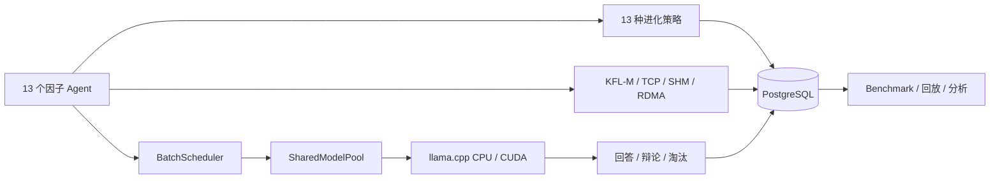

<div align="center">


# Civilization Spark

**十三因子多智能体 LLM 文明实验台**

13 agents · shared llama.cpp model · 13 AI learning routes · CUDA · PostgreSQL · KFL-M

[](https://isocpp.org/)
[](https://developer.nvidia.com/cuda-toolkit)
[](https://www.postgresql.org/)
[](LICENSE)
[](https://github.com/TanLB1289808226/civilization-spark/actions/workflows/ci.yml)

</div>

---

## 这是什么

Civilization Spark 是一个 C++23 多智能体 LLM 实验台。13 个因子共享同一个 llama.cpp 模型和
KV 上下文，但各自绑定不同的现代 AI 学习路线和独有进化方式；它们通过辩论、学习、淘汰和
重生，持续回答同一个问题：

> **何为生命第一因？**

它适合研究多 Agent 共享推理、不同学习策略的长期差异、Agent 状态持久化、压缩通信，
以及 CUDA kernel 与 llama.cpp GPU 后端的组合，而不是替代通用聊天产品。

## 核心特性

| 能力 | 实现 |
| --- | --- |
| 13 个因子 | 黄金裔、泰坦路径、原动力、模拟命途、AI 路线、独有进化 |
| 共享推理 | `SharedModelPool` + 多序列 batch decode + KV 滑动窗口 |
| 13 条学习路线 | 共识、约束 RL、经验回放、进化策略、对抗、蒸馏、奖励、批判、正则、竞争、剪枝、探索、元学习 |
| 压缩通信 | KFL-M v4、CRC8 / CRC32C、TCP / SHM / RoCEv2 接口 |
| 持久化 | PostgreSQL 18 / libpq：run、agent、round、event、metric、benchmark |
| GPU | llama.cpp CUDA 后端 + 自定义 elementwise / softmax attention |
| 基准测试 | 多 seed、多 repeat、结果自动写入 PostgreSQL |
| 可复现 | 固定 seed、确定性进化和可查询的运行记录 |

## 架构



## 13 个因子

<details>
<summary>展开 13 因子与 AI 学习路线</summary>

| # | 因子 | 黄金裔 | 路径 | 原动力 | 模拟命途 | AI 学习路线 |
| --- | --- | --- | --- | --- | --- | --- |
| 0 | Tribios | 缇宝 | 门径 | 同理 | 同谐 | 多智能体共识学习 |
| 1 | HubRis504 | 刻律德菈 | 律法 | 支配 | 秩序 | 约束强化学习 |
| 2 | PhiLia093 | 昔涟（最初的因子） | 岁月 | 哀怜 | 记忆 | 持续学习与经验回放 |
| 3 | 丹恒·腾荒 | 丹恒·腾荒 | 大地 | 求存 | 不朽 | 进化策略 |
| 4 | ApoRia432 | 海瑟音 | 海洋 | 自否 | 虚无 | 对抗学习与负采样 |
| 5 | 雅辛忒丝 | 风堇 | 天空 | 奉献 | 存护 | 知识蒸馏与协作学习 |
| 6 | NeiKos496 | 白厄 | 负世 | 憎恨 | 毁灭 | 奖励最大化强化学习 |
| 7 | SkeMma720 | 那刻夏 | 理性 | 批判 | 智识 | 主动学习与符号推理 |
| 8 | 阿格莱雅 | 阿格莱雅 | 浪漫 | 节制 | 纯美 | 正则化与审美约束 |
| 9 | 迈德漠斯 | 万敌 | 纷争 | 约束 | 巡猎 | 竞争式协同进化 |
| 10 | EpieiKeia216 | 遐蝶 | 死亡 | 平和 | 均衡 | 模型剪枝与均衡学习 |
| 11 | OreXis945 | 赛飞儿 | 诡计 | 渴望 | 欢愉 | 好奇心驱动探索 |
| 12 | 德谬歌 | 昔涟（第十三因子） | 岁月/全世 | 爱？（待确认） | 记忆/开拓 | 元学习与多模态融合 |

</details>

每个因子的身份、第一因文本和进化方式集中在
[`src/ai/llm_agent.cpp`](src/ai/llm_agent.cpp) 的 `kAgentProfiles` 表中。

## 快速开始

### Linux / 租用 GPU 一键运行

```bash
git clone --recursive https://github.com/TanLB1289808226/civilization-spark.git
cd civilization-spark
bash scripts/linux_oneclick.sh
```

脚本会检查 GPU / 显存，安装依赖，下载约 2.6 GB 的 Spark Q4_K_M 模型，按显存选择上下文，
构建 CUDA 版本并运行。

```bash
bash scripts/linux_oneclick.sh --cuda-test
bash scripts/linux_oneclick.sh --benchmark
bash scripts/linux_oneclick.sh --no-model --no-postgres
```

### Windows + CLion

```powershell
git clone --recursive https://github.com/TanLB1289808226/civilization-spark.git
cd civilization-spark
.\scripts\download_model.ps1
```

用 CLion 打开项目，选择 `cuda-release` 或 `cpu-release` preset。也可以命令行构建：

```powershell
cmake --preset cuda-release
cmake --build --preset cuda-release
.\build\cuda-release\civ_main.exe 42
```

如果本机 PostgreSQL 是便携版，配置时追加：

```powershell
cmake --preset cpu-release -DPostgreSQL_ROOT=D:/pgsql/pgsql
```

### Docker

```bash
docker build -t civilization-spark .
docker run --rm --gpus all civilization-spark
```

## 运行时配置

| 环境变量 | 作用 | 示例 |
| --- | --- | --- |
| `CIV_LLAMA_MODEL` | GGUF 模型路径 | `models/Spark-X2.5-4B-Q4_K_M.gguf` |
| `CIV_N_CTX` | 每个 Agent 的上下文长度 | `512`（6 GB 显存） |
| `CIV_N_GPU_LAYERS` | offload 到 GPU 的层数 | `99` |
| `CIV_PG_DSN` | PostgreSQL 连接串 | `host=127.0.0.1 port=5432 dbname=civ user=civ password=civpass` |
| `CIV_BENCH_SEEDS` | benchmark seed 列表 | `42,43,44` |
| `CIV_BENCH_REPEAT` | 每个 seed 重复次数 | `2` |

没有 GPU 时，取消模型环境变量即可回退到内置 CPU 演示路径。

## 验证结果

本机环境：AMD Ryzen 7 5800H、32 GB RAM、RTX 3060 Laptop 6 GB。

| 项目 | 结果 |
| --- | --- |
| 核心单元测试 | 22 项通过 |
| 13 因子档案 / 进化测试 | 5 项通过 |
| PostgreSQL CRUD + 并发 | 通过（4 连接） |
| PostgreSQL 主从复制 | 主库写入，5433 standby 可读；standby 写入被拒绝 |
| CUDA elementwise | 最大误差 `0` |
| CUDA attention softmax | 最大误差 `7.45e-09` |
| GPU 13-Agent 单轮 | 约 1.4–2.0 秒 |
| 3-seed 7 轮 benchmark | 14.35s / 12.50s / 13.52s |

详细记录：[docs/分析与修复报告.md](docs/分析与修复报告.md)

## 项目结构

```text
apps/              civ_main / civ_bench / civ_distributed
cuda/              自定义 CUDA kernel
docs/              架构、PostgreSQL、修复与基准记录
include/civ/       公共头文件
scripts/           Linux 一键、模型下载
src/ai/            模型池、批量调度、Agent
src/civilization/  文明模拟
src/channel/       TCP / SHM / RoCEv2
src/storage/       PostgreSQL libpq 存储层
tests/             核心、因子、存储、CUDA 测试
third_party/       llama.cpp submodule
```

## 路线图

- [x] 13 因子身份与 13 条 AI 学习路线
- [x] llama.cpp 共享模型与 KV 滑动窗口
- [x] PostgreSQL 持久化、主从复制
- [x] GPU 推理与 CUDA kernel 数值验证
- [x] 多 seed benchmark
- [ ] 多 Agent 推理运行时进一步模块化
- [ ] RDMA 双机吞吐/延迟实测
- [ ] 自动化 benchmark 报告与图表
- [ ] Web UI / 回放界面

## 文档

- [项目分析与修复报告](docs/分析与修复报告.md)
- [PostgreSQL 持久化与多节点](docs/POSTGRES.md)
- [基准测试](docs/BENCHMARKS.md)
- [贡献指南](CONTRIBUTING.md)
- [安全策略](SECURITY.md)

## License

MIT License. See [LICENSE](LICENSE).
