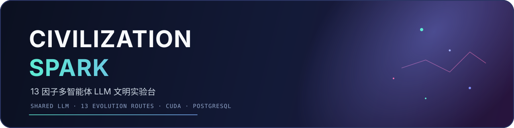
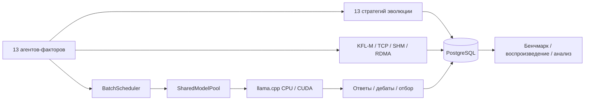

<div align="center">

[English](README.md) · [简体中文](README.zh-CN.md) · [Русский](README.ru.md)



# Civilization Spark

**Многоагентная LLM-лаборатория цивилизации на основе 13 факторов**

13 агентов · общая модель llama.cpp · 13 маршрутов обучения ИИ · CUDA · PostgreSQL · KFL-M

[](https://isocpp.org/)
[](https://developer.nvidia.com/cuda-toolkit)
[](https://www.postgresql.org/)
[](LICENSE)
[](https://github.com/TanLB1289808226/civilization-spark/actions/workflows/ci.yml)

</div>

---

## Что это?

Civilization Spark — лаборатория многоагентных LLM на C++23. Тринадцать агентов-факторов
совместно используют одну модель llama.cpp и общий KV-контекст, но каждый следует своему
маршруту обучения и собственному правилу эволюции. Через дебаты, обучение, отбор и
перерождение они отвечают на один вопрос:

> **Что является первой причиной жизни?**

Проект предназначен для исследования:

- совместного использования модели, KV-кэша и пакетного декодирования;
- долгосрочных различий между стратегиями обучения;
- надёжного хранения и воспроизведения состояния агентов;
- сжатого обмена сообщениями через TCP, разделяемую память и RoCEv2;
- собственных CUDA-ядер вместе с GPU-бэкендом llama.cpp.

Это не замена универсальному чат-продукту.

## Возможности

| Возможность | Реализация |
| --- | --- |
| 13 факторов | Наследник, путь Титана, движущая сила, моделируемый путь, маршрут ИИ, уникальная эволюция |
| Общий вывод | `SharedModelPool` + пакетное декодирование нескольких последовательностей + скользящее окно KV |
| 13 маршрутов обучения | Консенсус, RL с ограничениями, replay, эволюционные стратегии, adversarial, дистилляция, награда, критика, регуляризация, конкуренция, прунинг, исследование, метаобучение |
| Сжатые сообщения | KFL-M v4, CRC8 / CRC32C, интерфейсы TCP / SHM / RoCEv2 |
| Хранение | PostgreSQL 18 / libpq: runs, agents, rounds, events, metrics, benchmarks |
| GPU | CUDA-бэкенд llama.cpp + собственные elementwise / softmax attention |
| Бенчмарки | Несколько seed и повторов, результаты пишутся в PostgreSQL |
| Воспроизводимость | Фиксированные seed, детерминированная эволюция, запросы к истории запусков |

## Архитектура



## 13 факторов

<details>
<summary>Развернуть таблицу факторов и маршрутов ИИ</summary>

| # | Фактор | Наследник | Путь | Движущая сила | Моделируемый путь | Маршрут обучения ИИ |
| --- | --- | --- | --- | --- | --- | --- |
| 0 | Tribios | 缇宝 | 门径 | 同理 | 同谐 | Многоагентное обучение консенсусу |
| 1 | HubRis504 | 刻律德菈 | 律法 | 支配 | 秩序 | RL с ограничениями |
| 2 | PhiLia093 | 昔涟（最初的因子） | 岁月 | 哀怜 | 记忆 | Непрерывное обучение и experience replay |
| 3 | 丹恒·腾荒 | 丹恒·腾荒 | 大地 | 求存 | 不朽 | Эволюционные стратегии |
| 4 | ApoRia432 | 海瑟音 | 海洋 | 自否 | 虚无 | Adversarial learning и negative sampling |
| 5 | 雅辛忒丝 | 风堇 | 天空 | 奉献 | 存护 | Дистилляция знаний и кооперативное обучение |
| 6 | NeiKos496 | 白厄 | 负世 | 憎恨 | 毁灭 | RL с максимизацией награды |
| 7 | SkeMma720 | 那刻夏 | 理性 | 批判 | 智识 | Активное обучение и символьный вывод |
| 8 | 阿格莱雅 | 阿格莱雅 | 浪漫 | 节制 | 纯美 | Регуляризация и эстетические ограничения |
| 9 | 迈德漠斯 | 万敌 | 纷争 | 约束 | 巡猎 | Конкурентная коэволюция |
| 10 | EpieiKeia216 | 遐蝶 | 死亡 | 平和 | 均衡 | Прунинг и сбалансированное обучение |
| 11 | OreXis945 | 赛飞儿 | 诡计 | 渴望 | 欢愉 | Исследование на основе любопытства |
| 12 | 德谬歌 | 昔涟（第十三因子） | 岁月/全世 | 爱？（待确认） | 记忆/开拓 | Метаобучение и мультимодальное слияние |

</details>

Профили, ответы о первой причине и методы эволюции находятся в таблице
`kAgentProfiles` в [`src/ai/llm_agent.cpp`](src/ai/llm_agent.cpp).

## Быстрый старт

### Linux / арендованный GPU

```bash
git clone --recursive https://github.com/TanLB1289808226/civilization-spark.git
cd civilization-spark
bash scripts/linux_oneclick.sh
```

Скрипт проверит GPU и VRAM, установит зависимости, скачает модель Spark Q4_K_M
(~2,6 ГБ), выберет размер контекста по объёму памяти, соберёт CUDA-версию и запустит
симуляцию.

```bash
bash scripts/linux_oneclick.sh --cuda-test
bash scripts/linux_oneclick.sh --benchmark
bash scripts/linux_oneclick.sh --no-model --no-postgres
```

### Windows + CLion

```powershell
git clone --recursive https://github.com/TanLB1289808226/civilization-spark.git
cd civilization-spark
.\scripts\download_model.ps1
```

Откройте проект в CLion и выберите preset `cuda-release` или `cpu-release`.

```powershell
cmake --preset cuda-release
cmake --build --preset cuda-release
.\build\cuda-release\civ_main.exe 42
```

Для портативного PostgreSQL:

```powershell
cmake --preset cpu-release -DPostgreSQL_ROOT=D:/pgsql/pgsql
```

### Docker

```bash
docker build -t civilization-spark .
docker run --rm --gpus all civilization-spark
```

## Конфигурация

| Переменная | Назначение | Пример |
| --- | --- | --- |
| `CIV_LLAMA_MODEL` | Путь к GGUF-модели | `models/Spark-X2.5-4B-Q4_K_M.gguf` |
| `CIV_N_CTX` | Контекст на одного агента | `512` для 6 ГБ VRAM |
| `CIV_N_GPU_LAYERS` | Слоёв на GPU | `99` |
| `CIV_PG_DSN` | Строка подключения PostgreSQL | `host=127.0.0.1 port=5432 dbname=civ user=civ password=civpass` |
| `CIV_BENCH_SEEDS` | Список seed для бенчмарка | `42,43,44` |
| `CIV_BENCH_REPEAT` | Повторов на seed | `2` |

Без GPU уберите `CIV_LLAMA_MODEL`, чтобы использовать встроенный CPU-путь.

## Проверка

Локальная машина: AMD Ryzen 7 5800H, 32 ГБ RAM, NVIDIA RTX 3060 Laptop 6 ГБ.

| Область | Результат |
| --- | --- |
| Основные unit-тесты | 22 пройдено |
| Тесты факторов и эволюции | 5 пройдено |
| PostgreSQL CRUD + конкурентность | Пройдено с 4 соединениями |
| PostgreSQL primary/standby | Запись видна на standby; запись в standby отклонена |
| CUDA elementwise | Максимальная ошибка `0` |
| CUDA attention softmax | Максимальная ошибка `7.45e-09` |
| GPU-пакет 13 агентов | ~1,4–2,0 с на раунд |
| Бенчмарк 3 seed × 7 раундов | 14,35 с / 12,50 с / 13,52 с |

Подробный отчёт: [docs/分析与修复报告.md](docs/分析与修复报告.md)

## Структура проекта

```text
apps/              civ_main / civ_bench / civ_distributed
cuda/              собственные CUDA-ядра
docs/              архитектура, PostgreSQL, бенчмарки и отчёты
include/civ/       публичные заголовки
scripts/           Linux one-click и загрузка модели
src/ai/            пул модели, планировщик, агенты
src/civilization/  симуляция цивилизации
src/channel/       TCP / SHM / RoCEv2
src/storage/       слой хранения PostgreSQL libpq
tests/             тесты ядра, факторов, хранения и CUDA
third_party/       submodule llama.cpp
```

## Планы

- [x] 13 факторов и 13 маршрутов обучения ИИ
- [x] Общая модель llama.cpp и скользящее окно KV
- [x] PostgreSQL и репликация primary/standby
- [x] GPU-инференс и проверка CUDA-ядер
- [x] Бенчмарк с несколькими seed
- [ ] Модульный runtime для многоагентного вывода
- [ ] Измерение пропускной способности и задержки RDMA
- [ ] Автоматические отчёты и графики бенчмарков
- [ ] Web UI / интерфейс воспроизведения

## Документация

- [Анализ проекта и отчёт об исправлениях (китайский)](docs/分析与修复报告.md)
- [PostgreSQL и многоузловая настройка](docs/POSTGRES.md)
- [Бенчмарки](docs/BENCHMARKS.md)
- [Участие в разработке](CONTRIBUTING.ru.md) · [English](CONTRIBUTING.md) · [简体中文](CONTRIBUTING.zh-CN.md)
- [Политика безопасности](SECURITY.md)

## Лицензия

MIT License. См. [LICENSE](LICENSE) · [简体中文](LICENSE.zh-CN.md) · [Русский](LICENSE.ru.md).
